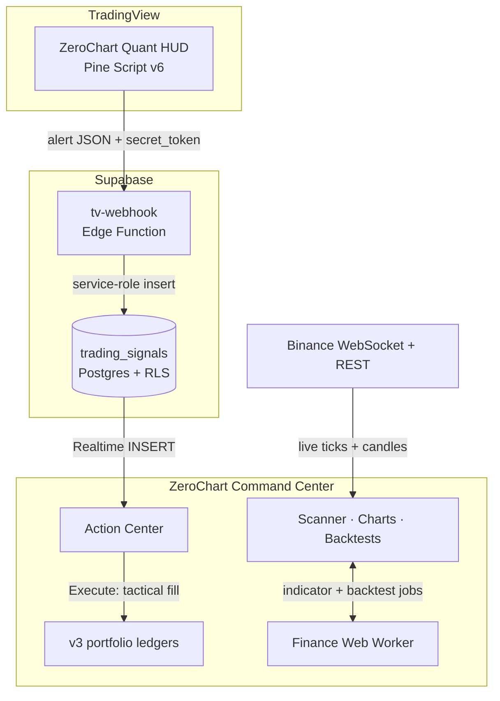

<div align="center">

# ZeroChart

**Institutional-grade quantitative trading and wealth management ecosystem.**

A TradingView Pine Script HUD that scores every bar, and a React + Supabase command center that turns those scores into sized, audited paper trades.

[](https://github.com/blackhebrewisraeli/ZeroChart/actions/workflows/ci.yml)
[](https://www.typescriptlang.org/)
[](https://react.dev/)
[](https://supabase.com/)
[](https://www.tradingview.com/pine-script-docs/)
[](./LICENSE)

[**Live app**](https://zero-chart.vercel.app) · [Architecture](#the-ecosystem) · [Features](#flagship-features) · [Getting started](#getting-started) · [Docs](#documentation)

</div>

> [!NOTE]
> ZeroChart is research and paper-trading software. Its scores, position sizes, and backtests are informational, not financial advice, and no real orders are ever placed.

## The ecosystem

ZeroChart is two products running one quant engine. The same RSI / MACD / ATR model is implemented in TypeScript for the web app and ported 1:1 to Pine Script, so the score on your TradingView chart matches the score in the app.

|                      | **ZeroChart Quant HUD**                                                                                    | **ZeroChart Command Center**                                                                      |
| -------------------- | ---------------------------------------------------------------------------------------------------------- | ------------------------------------------------------------------------------------------------- |
| **Runs on**          | TradingView, as a Pine Script v6 overlay                                                                   | The browser: React 19 on TanStack Start, backed by Supabase                                       |
| **Job**              | Live visual signals on any chart                                                                           | Portfolio accounting, strategy backtesting, paper-trade execution                                 |
| **Shows**            | On-chart HUD table: quant score, market regime, factor breakdown, position size, ATR stop, one-line thesis | Market scanner, wealth dashboard, Robo-Advisor, backtester, Paper Trading terminal, Action Center |
| **Emits / consumes** | Emits alerts: high-conviction bullish, regime shift to high volatility, ATR trailing-stop breach           | Consumes those alerts through a secured webhook, in real time                                     |
| **Source**           | [`pine/zerochart_quant_hud.pine`](./pine/zerochart_quant_hud.pine)                                         | [`src/`](./src) and [`supabase/`](./supabase)                                                     |



## Flagship features

### Web Worker multi-factor engine

- Scores every asset 0–100 by blending three normalized factors: **RSI** mean reversion (40%), **MACD** momentum (40%), and **ATR** volatility regime (20%).
- Detects the market regime (high volatility, trending, mean-reverting, or neutral) and tilts the weights toward the factor that regime rewards. Missing inputs redistribute their weight instead of faking a reading.
- Every score is explainable: sub-scores, applied weights, regime, and a one-line rationale come from [`multiFactor.ts`](./src/lib/multiFactor.ts).
- Heavy math (SMA, RSI, MACD, ATR, full backtests) runs off the main thread in [`finance.worker.ts`](./src/lib/finance.worker.ts), with results cached and served through the async [`financeClient.ts`](./src/lib/financeClient.ts) API, so charts never freeze the UI.

### v3 atomic accounting

- Three strictly isolated ledgers per user: **Live Tracking**, **Simulation**, and **Paper Trading**, each with its own positions, cash, cash ledger, transactions, and realized P&L.
- Every buy, sell, deposit, and withdrawal is a pure, immutable state transition in [`portfolioAccounting.ts`](./src/lib/portfolioAccounting.ts). Positions, cash, and the transaction log move together, or the trade is rejected and nothing changes.
- Multi-lot cost basis, FIFO lot consumption on sells, and fee- and slippage-aware realized P&L. Valuation reports missing prices honestly instead of guessing.
- Older v1 and v2 payloads migrate deterministically into the v3 snapshot on load.

### Dynamic position sizing

- ATR-based sizing in [`risk.ts`](./src/lib/risk.ts): a one-ATR move against the trade loses exactly your chosen risk (2% of capital by default).
- Hard invariants: notional never exceeds the capital or per-asset budget, the stop price is floored at zero, and rounding never breaches the budget.
- The same formula drives the Robo-Advisor, the asset detail view, and the Pine HUD's position-size row.

### Real-time webhook Action Center

- TradingView alerts post to the [`tv-webhook`](./supabase/functions/tv-webhook/index.ts) Edge Function. Each user authenticates with a rotating `secret_token` that is stored only as a SHA-256 hash.
- Payloads are validated (ticker, BUY/SELL action, 0–100 score, size, optional stop) and land in `trading_signals` as `PENDING`.
- The [Action Center](./src/components/ActionCenter.tsx) streams new signals over Supabase Realtime. **Execute** books a tactical fill into the Paper Trading ledger at the live price; **Dismiss** retires the signal.
- Row-level security lets users read only their own signals and move them out of `PENDING` once. Ticker, size, and stop are writable only by the webhook, so the audit trail can't be rewritten.

### Also included

| Feature                  | What it does                                                                                                                     |
| ------------------------ | -------------------------------------------------------------------------------------------------------------------------------- |
| **Live market stream**   | Binance all-market ticker over WebSocket, batched into a `useSyncExternalStore` store so only rows whose price changed re-render |
| **Canvas charts**        | `lightweight-charts` candlesticks with SMA 50/200 and a synchronized RSI pane                                                    |
| **Backtesting**          | Replays an allocation over a year of daily candles, with max drawdown and Sharpe ratio                                           |
| **Robo-Advisor**         | Builds a signal-ranked, risk-weighted portfolio from your capital and risk profile                                               |
| **Price alerts**         | Cloud-synced (RLS) for signed-in users, session-only for guests; each alert fires exactly once                                   |
| **Shareable portfolios** | Read-only snapshot links at `/p/:portfolioId` that anyone can open                                                               |

## Tech stack

| Layer           | Technology                                                                                                                                            |
| --------------- | ----------------------------------------------------------------------------------------------------------------------------------------------------- |
| **Frontend**    | [React 19](https://react.dev/), [TanStack Start](https://tanstack.com/start) (SSR + file-based routing), [TanStack Query](https://tanstack.com/query) |
| **Build**       | [Vite](https://vite.dev/), [TypeScript](https://www.typescriptlang.org/) (strict)                                                                     |
| **Styling**     | [Tailwind CSS v4](https://tailwindcss.com/), [shadcn/ui](https://ui.shadcn.com/) on Radix primitives, [Framer Motion](https://motion.dev/)            |
| **Charts**      | [lightweight-charts](https://www.tradingview.com/lightweight-charts/) (Canvas), [Recharts](https://recharts.org/)                                     |
| **Compute**     | Web Workers for indicator and backtest math                                                                                                           |
| **Backend**     | [Supabase](https://supabase.com/): Postgres + RLS, Auth, Realtime, Edge Functions (Deno)                                                              |
| **Market data** | Binance WebSocket and REST APIs                                                                                                                       |
| **Indicator**   | [Pine Script v6](https://www.tradingview.com/pine-script-docs/) on TradingView                                                                        |
| **Quality**     | [Vitest](https://vitest.dev/), Testing Library, ESLint, Prettier, GitHub Actions                                                                      |

## Getting started

### Prerequisites

- [Node.js](https://nodejs.org/) 22+ (or [Bun](https://bun.sh/))
- A [Supabase](https://supabase.com/) project

### 1. Clone and install

```bash
git clone https://github.com/blackhebrewisraeli/ZeroChart.git
cd ZeroChart
npm install
```

### 2. Configure environment variables

```bash
cp .env.example .env.local
```

Then fill in the two values from **Supabase → Project Settings → API**:

```env
VITE_SUPABASE_URL=https://<your-project-ref>.supabase.co
# Publishable key (sb_publishable_...); a legacy anon key also works
VITE_SUPABASE_PUBLISHABLE_KEY=sb_publishable_...
```

> [!WARNING]
> Only the publishable (anon) key belongs in the frontend. Never put a service-role or secret key in `.env.local`.

### 3. Set up the database

Apply the core schema (`assets_status`, `user_portfolios`, `user_alerts`) with your project's Postgres connection string, found under **Project Settings → Database**:

```bash
export DATABASE_URL="postgresql://postgres:<password>@db.<your-project-ref>.supabase.co:5432/postgres"
for f in drizzle/migrations/000*.sql; do psql "$DATABASE_URL" -v ON_ERROR_STOP=1 -f "$f"; done
```

Then link the Supabase CLI and push the remaining migrations (shared portfolios, trading signals):

```bash
npx supabase link --project-ref <your-project-ref>
npx supabase db push
```

Finally, make sure **Email** is enabled under **Authentication → Providers**.

### 4. Run the dev server

```bash
npm run dev
```

Open [http://localhost:8080](http://localhost:8080).

### 5. Optional: connect TradingView

1. Deploy the webhook (JWT verification is already turned off for it in [`supabase/config.toml`](./supabase/config.toml)):

   ```bash
   npx supabase functions deploy tv-webhook
   ```

2. In the app, open any asset and click **TradingView Indicator**. Copy the Pine Script, then click **Generate webhook token** to get your webhook URL and a ready-made alert message.
3. Add the indicator to a TradingView chart, create an alert, and paste the webhook URL and alert message into it.

### Scripts

| Command              | Purpose                            |
| -------------------- | ---------------------------------- |
| `npm run dev`        | Start the dev server on port 8080  |
| `npm run build`      | Production build                   |
| `npm run preview`    | Serve the production build locally |
| `npm test`           | Run the Vitest suite once          |
| `npm run test:watch` | Run Vitest in watch mode           |
| `npm run lint`       | ESLint                             |
| `npm run format`     | Prettier                           |
| `npx tsc --noEmit`   | Typecheck                          |

## Project structure

```text
pine/                     ZeroChart Quant HUD (Pine Script v6)
src/
├── components/           Workspace shell, Action Center, charts, dashboards, modals
│   └── ui/               shadcn/ui primitives
├── hooks/                Binance WebSocket, alert engine, price flash, session timeout
├── integrations/         Supabase client re-exports, generated DB types, auth middleware
├── lib/                  Pure engines: indicators, multiFactor, risk, backtest, accounting
│   └── finance.worker.ts Web Worker for heavy indicator and backtest math
├── routes/               TanStack Start file-based routes
└── test/                 Vitest suites
supabase/
├── functions/tv-webhook/ TradingView alert ingestion (Deno Edge Function)
└── migrations/           Shared portfolios, trading signals, webhook tokens
drizzle/migrations/       Core schema: assets_status, user_portfolios, user_alerts
docs/                     Architecture, roadmap, and audit documents
```

## Quality gates

Every pull request to `main` runs [CI](./.github/workflows/ci.yml): typecheck, build, lint, and the full test suite. Run the same checks locally before you push:

```bash
npx tsc --noEmit && npm run build && npm run lint && npm test
```

The finance core (indicators, multi-factor scoring, position sizing, accounting, backtesting, alert evaluation, webhook payload parsing) is pure and unit-tested.

## Documentation

| Document                                             | What's inside                                                                                                  |
| ---------------------------------------------------- | -------------------------------------------------------------------------------------------------------------- |
| [Hybrid architecture](./docs/hybrid-architecture.md) | Target architecture, reusable engine inventory, and the path from JSONB snapshots to a normalized domain model |
| [Hybrid roadmap](./docs/hybrid-roadmap.md)           | Milestone 1 and 2 plans, execution checkpoints, and open questions                                             |
| [Roadmap](./docs/roadmap.md)                         | Completed launch milestones                                                                                    |
| [Engineering audit](./docs/engineering-audit.md)     | Milestone 0 findings register and remediation log                                                              |
| [Supabase connection](./docs/CONNECTION.md)          | Data contract for the `assets_status` market table                                                             |
| [Agent conventions](./docs/AGENTS.md)                | Architecture rules for coding agents working in this repo                                                      |
| [Contributing](./CONTRIBUTING.md)                    | Dev setup, coding standards, and the pull request process                                                      |

## Contributing

Contributions are welcome. Read [CONTRIBUTING.md](./CONTRIBUTING.md) first; the short version is to keep engines pure and tested, keep heavy math in the Web Worker, and put RLS on every table.

## License

Released under the [MIT License](./LICENSE).

<div align="center">

**ZeroChart: signal over noise.**

[Back to top](#zerochart)

</div>
