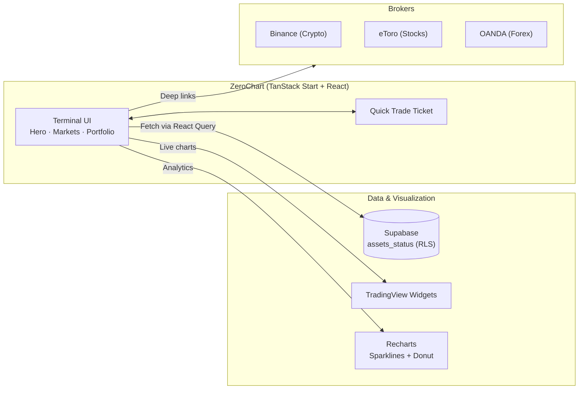

<div align="center">

# ZeroChart

**A premium Cyber Finance / High-Frequency Trading (HFT) terminal.**

ZeroChart turns raw market data into a single, high-signal trading workspace — deterministic Signal Scores, live TradingView charts, portfolio analytics, and a one-tap order ticket, wrapped in an Electric Cyan terminal UI with full Light/Dark mode.

[](https://tanstack.com/start)
[](https://react.dev/)
[](https://supabase.com/)
[](https://vercel.com/)

[Quick start](#quick-start) · [System at a glance](#system-at-a-glance) · [Documentation](./docs/AGENTS.md)

</div>

## Highlights

| Capability | Description |
| --- | --- |
| **Deterministic Signal Score** | A 0–100 rating computed on the fly from Risk/Reward, trend lines, and volume spikes. |
| **High-Density Markets Table** | A scannable terminal grid sorted by Top Signals, Top Gainers, or Top Losers across Crypto, Stocks, and Forex. |
| **Electric Cyan terminal UI** | A `#00E5FF` brand primary, Light/Dark mode via `next-themes`, and deterministic green/red signal colors. |
| **Live Price Flashes** | Prices flash neon green/red on every tick, powered by a lightweight HFT-style price simulator. |
| **Portfolio Allocation Donut** | A Recharts donut chart that breaks down holdings by percentage of total value. |
| **Quick Trade Order Ticket** | A slide-over ticket with a Buy/Sell toggle, large amount input, live fee/total summary, and mock execution. |

## What's inside

- **Hero Pick** — the top-rated asset of the day with an embedded TradingView Advanced Chart.
- **Markets scanner** — filter and sort the full asset universe across asset classes.
- **Robo-Advisor** — builds equal-weight portfolios from user capital and a risk profile.
- **Portfolio dashboard** — KPI cards, per-holding sparklines, and an allocation donut.
- **Broker routing** — deep-links to Binance, eToro, or OANDA by asset class.

## System at a glance



## Tech stack

TanStack Start (React 19 + Vite) · TanStack Query · Supabase (Postgres + RLS) · Recharts · Framer Motion · lucide-react · next-themes · Tailwind CSS v4 · sonner

## Quick start

**Prerequisites:** [Bun](https://bun.sh/) (recommended) or npm.

```bash
git clone https://github.com/blackhebrewisraeli/ZeroChart.git
cd ZeroChart
bun install
bun run dev
```

| Command | Purpose |
| --- | --- |
| `bun run dev` | Start the local development server |
| `bun run build` | Build the production bundle |
| `bun run test` | Run the test suite |
| `bun run lint` | Run ESLint |

See [docs/CONNECTION.md](./docs/CONNECTION.md) to wire up Supabase.

## Documentation

- [Architecture & conventions](./docs/AGENTS.md) — engineering conventions, design tokens, and product boundaries.
- [Supabase connection setup](./docs/CONNECTION.md) — required table, RLS, and local `.env.local` setup.
- [Roadmap](./docs/roadmap.md) — shipped and planned milestones.

## License

Released under the MIT License.

<div align="center">

**ZeroChart — signal over noise.**

[Back to top](#zerochart)

</div>
