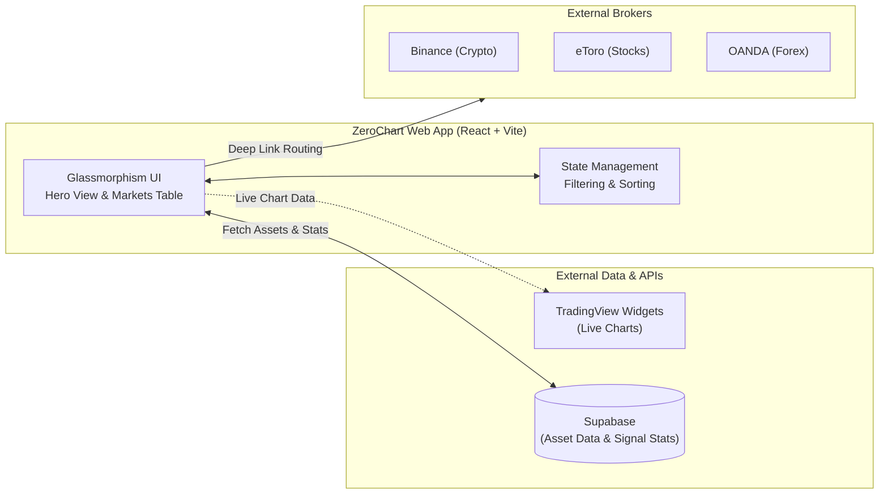

<div align="center">

<sup>ZEROCHART · BUILT FOR RETAIL INVESTORS</sup>

# ZeroChart — Algorithmic signals, consumer focus

**A premium fintech web application that transforms raw market data into a seamless "See → Understand → Invest" flow, blending a proprietary Signal Score, high-density market tables, and an automated Robo-Advisor.**

[](https://react.dev/)
[](https://vite.dev/)
[](https://supabase.com/)
[](https://vercel.com/)
[](./LICENSE)

[Try the app](#) ·
[Run it locally](#-quick-start) ·
[See the architecture](#-system-at-a-glance)

</div>

> [!NOTE]
> **This is an actionable signal terminal, not a paper-trading game.** We do not simulate virtual portfolios. Instead, ZeroChart ranks live assets and provides deep-links directly to external brokers (Binance, eToro, OANDA) so users can execute real trades instantly.

## ✨ What investors get

| Experience | What it does | 
| ----- | ----- | 
| 👑 **The Hero Pick** | The absolute highest-rated asset of the day dominates the screen. Data is humanized ("Upside Potential", "Volume Surging") for instant comprehension. | 
| 📊 **High-Density Markets Table** | A Binance-style scannable grid for "More Opportunities". Sort by Top Signals, Top Gainers, or Top Losers across Crypto, Stocks, and Forex. | 
| 🎯 **Proprietary Signal Score** | Every asset receives a `0-100` rating mathematically derived from its Risk/Reward ratio, SMA trend lines, and volume spikes. | 
| 📈 **Advanced Live Charts** | Integrated TradingView Advanced Charts wrap seamlessly into the dark glassmorphism UI, adjusting tickers automatically by asset class. | 
| 🤖 **Robo-Advisor (Backend)** | An algorithmic engine that builds diversified, equal-weight portfolios based on user capital and Risk Profiles (Conservative, Moderate, Aggressive). | 
| 🚀 **Frictionless Execution** | One-click "Trade" buttons dynamically route the user to the correct broker based on the ticker (`-USD` -> Binance, `=X` -> OANDA, else -> eToro). | 

## 🦸 Two things that make it unusual

<details open>
<summary><strong>🎯 ZeroChart replaces subjective analysis with a deterministic Signal Score</strong></summary>

The application computes a `0-100` integer on the fly, eliminating emotional trading:

```javascript
// 1. Calculate Base on Risk/Reward
const ratio = reward_pct / risk_pct; 
let score = 20 * ratio + 20; // e.g., ratio of 2 = 60 pts

// 2. Apply Technical Modifiers
if (volume_spike > 1) score += 15;
if (current_price > sma_50) score += 10;

// 3. Clamp
return Math.min(Math.round(score), 100);
```
</details>

<details open>
<summary><strong>🤖 Automated Portfolio Generation (Robo-Advisor)</strong></summary>

Rather than just displaying signals, ZeroChart includes a backend infrastructure for automated portfolio generation based on risk tolerance.

The `generatePortfolio` engine:
1. Receives `totalCapital` and `riskProfile` ('conservative', 'moderate', 'aggressive').
2. Filters out any asset with a Signal Score below **70**.
3. Selects a targeted number of holdings based on risk (e.g., Aggressive focuses on the top 3 assets; Conservative spreads across 8).
4. Calculates equal-weight allocations to the exact cent, ensuring capital is distributed safely among high-probability setups.
</details>

## 🧭 System at a glance



## ⚡ Quick start

**Prerequisites:** [Bun](https://bun.sh/) is recommended for the fastest dependency installation and test execution.

```bash
git clone https://github.com/blackhebrewisraeli/ZeroChart.git
cd ZeroChart
bun install
```

| Command | Purpose | 
| ----- | ----- | 
| `bun run dev` | Start the Vite local development server | 
| `bun run build` | Build the production bundle | 
| `bun run test` | Run the test suite (Signal Score, Routing, Robo-Advisor) | 
| `bun run lint` | Run ESLint | 

## 🤝 Contributing

Bug reports, UI/UX improvements, and logic refinements are welcome. Please read `AGENTS.md` first — it is the single source of truth for this project's engineering conventions, design tokens (neon green/red), and product boundaries.

## 📄 License

Released under the [MIT License](./LICENSE).

<div align="center">

**ZeroChart — Data that drives action.**

[Back to top](#zerochart--algorithmic-signals-consumer-focus)

</div>
